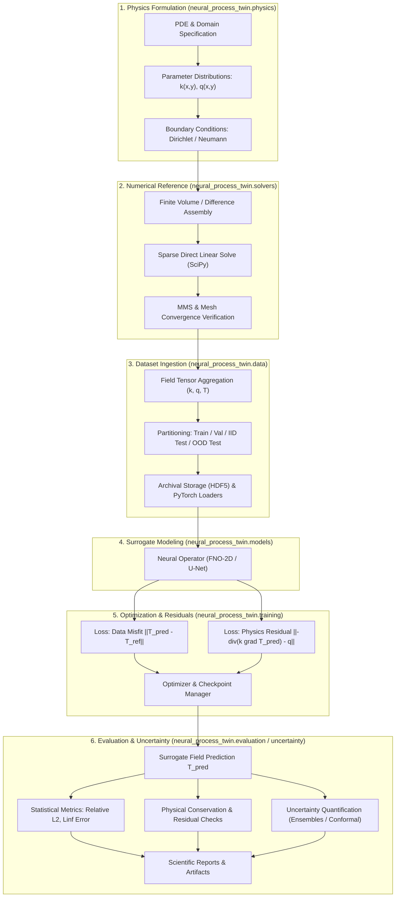

# Neural Process Twin: Architecture and System Design

## 1. System Overview and Architectural Principles

**Neural Process Twin** is architected as a modular, research-grade scientific machine learning system designed to learn surrogate approximations of partial differential equation (PDE) solution operators.

The architecture adheres to the following foundational engineering principles:

1. **Decoupled Responsibilities (Separation of Concerns)**: Physical formulations, numerical solvers, machine learning models, and training loops reside in isolated modules with minimal public interface boundaries.
2. **Strict Layering and No Circular Imports**: Dependencies flow unidirectionally from foundational physics to numerical solvers, data pipelines, model definitions, training routines, and finally evaluation and reporting.
3. **Purity of Scientific Calculations**: Mathematical and numerical routines are pure functions or stateless classes that do not depend on plotting libraries, UI frameworks, or execution environments.
4. **Reproducibility by Design**: Configuration objects, random seeds, hardware metadata, and model state are fully captured and serialized with every artifact.

---

## 2. Intended End-to-End Data Flow

The following sequence illustrates the end-to-end data progression from physical problem definition to surrogate inference and physical residual validation:



---

## 3. Module Responsibilities and Public Interfaces

### 3.1 `neural_process_twin.physics`
- **Responsibility**: Define continuous and discretized spatial domains, boundary condition specifications, thermal parameter distributions, and exact manufactured solutions.
- **Implemented in Milestone 01**:
  - `SinusoidalMMSConstantK(x_min, x_max, y_min, y_max, k_0, t_0, amplitude)`: Manufactured 2D sinusoidal solution with constant conductivity.
  - `SinusoidalMMSVariableK(x_min, x_max, y_min, y_max, k_0, k_1, t_0, amplitude)`: Manufactured 2D solution with smooth spatially varying conductivity.
  - `LinearConduction1D(x_min, x_max, y_min, y_max, k_0, t_left, t_right)`: Exact 1D conduction between Dirichlet boundaries.

### 3.2 `neural_process_twin.solvers`
- **Responsibility**: Implement conventional, high-fidelity numerical solvers for steady-state heat conduction to create ground truth reference solutions.
- **Implemented in Milestone 01**:
  - `Grid2D`: Cell-centred 2D uniform Cartesian grid with coordinate metrics and field evaluation.
  - `BoundaryConditions`, `BoundaryCondition`, `BoundarySide`, `BoundaryType`: Physical boundary condition specifications.
  - `harmonic_average(k1, k2)`: Exact series thermal resistance averaging for interface conductivities.
  - `assemble_steady_heat_system(...) -> LinearSystem`: Conservative sparse matrix and RHS assembly.
  - `HeatConductionSolver2D(tolerance).solve(...) -> SolverResult`: Solves sparse linear system and computes diagnostics.
  - `compute_heat_balance(...) -> EnergyBalanceDiagnostics`: Independent physical energy conservation verification.
  - `calculate_gci(f1, f2, f3, r, safety_factor) -> dict`: Roache ASME Grid Convergence Index calculator.
  - `compute_relative_l2_error`, `compute_linf_error`, `estimate_convergence_rates`: Discretization error analysis tools.

### 3.3 `neural_process_twin.data`
- **Responsibility**: Synthesize parameter field ensembles, orchestrate reference solves, verify algebraic and physical conservation tolerances, archive to chunked compressed HDF5, provide worker-safe PyTorch Dataset and DataLoader ingestion, and encode boundary conditions deterministically into spatial tensors.
- **Implemented in Milestone 02 & 03**:
  - `GaussianRandomFieldGenerator`: O(N log N) spectral FFT Gaussian random field generation with Gaussian and Matérn ($\nu$) covariance kernels and positivity-preserving transformations (sigmoid, log-normal).
  - `CompositeMaterialGenerator`: Piecewise-constant composite material generation with circular/rectangular inclusions and sharp interface contrast.
  - `HeatSourceGenerator`: Volumetric heat source distributions ($q \equiv 0$, uniform, multi-peak Gaussian thermal blobs) with explicit peak volumetric rate [W/m³] semantics.
  - `BoundaryConditionSampler`: Samples well-posed Dirichlet and mixed Dirichlet-Neumann boundary condition configurations.
  - `encode_boundary_conditions` & `decode_boundary_conditions`: Deterministic 8-channel spatial boundary encoding separating normal-to-x and normal-to-y boundaries, eliminating corner ambiguities and providing 12 canonical model input channels: `[k, q, x, y, bc_dirichlet_mask_x, bc_dirichlet_val_x, bc_neumann_mask_x, bc_neumann_val_x, bc_dirichlet_mask_y, bc_dirichlet_val_y, bc_neumann_mask_y, bc_neumann_val_y]`.
  - `DatasetOrchestrator`: Orchestrates problem sampling, invokes `HeatConductionSolver2D`, checks algebraic residual ($\le 10^{-6}$) and physical energy balance ($\le 10^{-3}$), and supports both fail-fast and skip-and-audit failure policies.
  - `DatasetPartitionPlan`: Manages 4 disjoint partitions (`train`, `validation`, `test_iid`, `test_ood`) with deterministic seed derivation and explicit physical OOD criteria.
  - `FieldNormalizer`: Physics-aware feature normalizer fitted strictly on the `train` partition to prevent data leakage, supporting reversible temperature inversion.
  - `HDF5DatasetWriter` & `inspect_hdf5_dataset`: Compressed, chunked HDF5 archive format (`v1.0.0`) storing grid geometries, fields ($k, q, T$), boundary conditions, diagnostics, normalization parameters, and audit manifests.
  - `HeatFieldDataset` & `create_dataloader`: Multi-worker safe PyTorch Dataset yielding 12-channel canonical input tensors (`include_bcs=True`) or 4-channel tensors (`include_bcs=False`) and target temperature tensors with lazy HDF5 worker-local file handles.

### 3.4 `neural_process_twin.models`
- **Responsibility**: Implement neural operator and baseline surrogate architectures mapping input coefficient and boundary fields to temperature fields.
- **Implemented in Milestone 03**:
  - `SurrogateModel`: Unified abstract base class defining the `(batch, in_channels, ny, nx) -> (batch, out_channels=1, ny, nx)` tensor contract, parameter counting (`count_parameters`), and device tracking.
  - `FourierNeuralOperator2D`: Continuous operator learning architecture with lifting projection $P$, $L$ Fourier layers combining `SpectralConv2D` with $1\times 1$ bypass convolutions, and projection decoder $Q$. Handles real FFT conjugate symmetry (`rfft2`/`irfft2`) across odd and even grid resolutions with Nyquist mode validation.
  - `SpectralConv2D`: 2D spectral convolution layer with complex frequency weights parameterizing positive and negative $y$-frequencies.
  - `CNNBaseline2D`: Deep fully-convolutional surrogate baseline with `ConvBlock2D` layers, residual skip connections, stable Kaiming normal initialization, and `replicate` padding mode to mitigate fictitious zero-boundary reservoir artifacts.
  - `build_model(config)`: Factory function instantiating surrogate architectures from typed `ModelConfig` or dictionary specifications.

### 3.5 `neural_process_twin.training`
- **Responsibility**: Execute training epochs, compute compound supervised and physics-informed losses, manage gradient updates, learning rate scheduling, validation monitoring, early stopping, and checkpoint persistence.
- **Implemented in Milestone 03 & 04**:
  - `RelativeL2Loss(reduction, eps)`: Numerically stable relative $L_2$ norm loss with denominator $\epsilon$ protection and `mean`/`sum`/`none` reduction options.
  - `DiscretePDEResidual`: Differentiable, vectorized PyTorch implementation of the conservative finite-volume operator evaluating $r_P = (A T - b)_P$ [W] with harmonic interface averaging and boundary flux contributions matching SciPy CSR sparse matrix assembly to machine precision ($< 10^{-10}$ W).
  - `DimensionlessPDELoss`: Scale-invariant PDE residual loss normalizing raw residuals by problem heat flow scale $\|b\|_2 + Q_{\text{floor}}$ with strictly positive denominator floor ($Q_{\text{floor}} > 0$). Supports `"full"` domain and `"interior"` control volume options.
  - `BoundaryConditionLoss`: Differentiable boundary condition loss penalizing Dirichlet face temperature error and Neumann outward heat flux error across active boundary edges.
  - `PhysicsAwareLoss`: Compound objective coordinating $\mathcal{L} = w_{\text{data}} \mathcal{L}_{\text{data}} + w_{\text{pde}} \mathcal{L}_{\text{pde}} + w_{\text{bc}} \mathcal{L}_{\text{bc}}$, providing detached component metrics (`loss_total`, `loss_data`, `loss_pde`, `loss_bc`) for transparent optimization telemetry.
  - `build_loss(config, grid, normalizer)`: Factory instantiating supervised or physics-aware loss modules based on typed `LossConfig` or dictionary parameters.
  - `save_checkpoint` & `load_checkpoint`: Complete reproducible model state persistence including weights, optimizer, scheduler, epoch, validation metrics, model architecture config, channel names, normalizer statistics, and runtime environment metadata (PyTorch version, NumPy version, timestamp).
  - `Trainer`: Supervised and physics-aware optimization manager with gradient norm clipping, NaN/Inf anomaly detection, validation monitoring, component loss history tracking (`train_loss_pde`, `train_loss_bc`, `val_loss_pde`), best model tracking, and early stopping.

### 3.6 `neural_process_twin.evaluation`
- **Responsibility**: Compute field prediction accuracy in physical units (Kelvin), evaluate discrete finite-volume physical residuals and boundary flux balance, and fairly benchmark inference performance against the reference numerical solver.
- **Implemented in Milestone 03**:
  - Physical metrics in Kelvin: `compute_relative_l2_error`, `compute_rmse`, `compute_mae`, `compute_max_absolute_error`, `compute_all_metrics`, and `compute_aggregate_statistics`.
  - Independent discrete PDE residuals & flux balance: `compute_discrete_pde_residual`, `compute_boundary_flux_diagnostics`, and `evaluate_physical_residuals` evaluating $\|A T_{\text{pred}} - b\|_2$ [W] and boundary flux imbalance using the reference solver's conservative stencils.
  - Partition evaluation: `evaluate_surrogate` and `evaluate_all_splits` evaluating frozen models across `validation`, `test_iid`, and `test_ood` partitions with worst-case outlier detection.
  - Benchmarking module: `benchmark_surrogate`, `benchmark_reference_solver`, and `compare_benchmarks` measuring single-sample latency (batch size 1) and batched throughput with warmup passes and device synchronization.

### 3.7 `neural_process_twin.uncertainty`
- **Responsibility**: Provide confidence bounds and risk-aware uncertainty metrics for predicted fields.
- **Key Planned Interfaces**:
  - `DeepEnsemble(models: list[nn.Module])`: Aggregates ensemble variance for spatial predictions.
  - `SpatialConformalPredictor(calibration_dataset)`: Computes distribution-free spatial coverage bands with guaranteed coverage probabilities $1 - \alpha$.

### 3.8 `neural_process_twin.utils`
- **Responsibility**: Cross-cutting utilities for configuration parsing, random seed control, logging, and environment inspection.
- **Implemented in Milestone 00**:
  - `ConfigurationError`, `ConfigurationMissingFieldError`, `ConfigurationValueError`.
  - `load_data_config(path) -> DataConfig`.
  - `load_training_config(path) -> TrainingConfig`.
  - `deep_merge(base, override) -> dict`.

---

## 4. Module Dependency Graph

```
neural_process_twin/
├── utils/           (Foundation: no internal project dependencies)
├── physics/         (Depends on utils)
├── solvers/         (Depends on physics, utils)
├── data/            (Depends on physics, solvers, utils)
├── models/          (Depends on utils, PyTorch)
├── training/        (Depends on models, data, physics, utils)
├── evaluation/      (Depends on models, physics, solvers, utils)
└── uncertainty/     (Depends on models, evaluation, utils)
```

No upward or circular imports are permitted.
