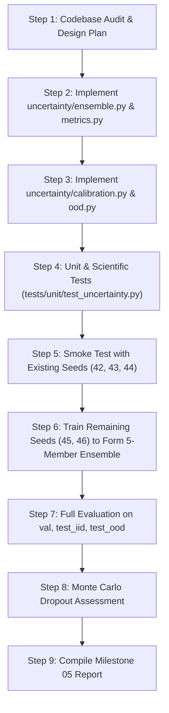

# Implementation Plan — Milestone 05: Uncertainty Estimation & OOD Detection

## 1. Executive Summary & Objective

The objective of **Milestone 05** is to design, implement, test, and evaluate uncertainty estimation and out-of-distribution (OOD) detection for **Neural Process Twin**. 

When deployed as a digital twin or surrogate in engineering workflows, the model must signal when its predictions are untrustworthy—particularly when encountering unseen thermal conductivity contrasts (up to 50:1), intense localized heat sources, or extreme boundary condition regimes.

---

## 2. Codebase Audit & Architectural Baseline

### 2.1 Existing Assets (Preserved)
- **Dataset**: [`artifacts/data/scaled_dataset.h5`](file:///c:/Workspace/Projects/Neural%20Process%20Twin/artifacts/data/scaled_dataset.h5) (1,550 samples, $32 \times 32$ grid):
  - `train`: 1,000 samples ($k$ contrast $\approx 4.5:1$, $\bar{q} \approx 41.9\text{ W/m}^3$)
  - `validation`: 150 samples (used strictly for checkpoint selection and conformal calibration)
  - `test_iid`: 200 samples (in-distribution evaluation)
  - `test_ood`: 200 samples (out-of-distribution evaluation, $k$ contrast up to $50:1$, $\bar{q}$ up to $3643.8\text{ W/m}^3$)
- **Existing Pre-Trained FNO Members**:
  - `artifacts/checkpoints/scaled_fno_supervised_seed42/best_model.pt`
  - `artifacts/checkpoints/scaled_fno_supervised_seed43/best_model.pt`
  - `artifacts/checkpoints/scaled_fno_supervised_seed44/best_model.pt`
  All three members were trained with identical architecture (FNO-2D, width 32, depth 4, 12 modes) and identical loss schedules.
- **Normalization**: `FieldNormalizer` (temperature scale: $\mu_T = 327.04\text{ K}$, $\sigma_T = 17.46\text{ K}$).
- **Physical Diagnostics**: [`evaluate_physical_residuals`](file:///c:/Workspace/Projects/Neural%20Process%20Twin/src/neural_process_twin/evaluation/residual.py) for finite-volume cell residuals ($r = AT - b$) and global heat flux imbalance ($|Q_{\mathrm{out}} - Q_{\mathrm{gen}}|$).

### 2.2 Architectural Scope in `src/neural_process_twin/uncertainty/`
The package `uncertainty/` is currently an empty scaffold. We will establish four modular, fully-tested components:

1. [`ensemble.py`](file:///c:/Workspace/Projects/Neural%20Process%20Twin/src/neural_process_twin/uncertainty/ensemble.py):
   - `DeepEnsemble`: Container for $M \ge 5$ trained `SurrogateModel` instances.
   - `EnsemblePrediction`: Dataclass encapsulating $\bar{T}(x, y)$, $s_T(x, y)$ (unbiased sample std, $ddof=1$), and individual member predictions.
   - Forward pass compatible with standard PyTorch modules for plug-and-play evaluation.
2. [`calibration.py`](file:///c:/Workspace/Projects/Neural%20Process%20Twin/src/neural_process_twin/uncertainty/calibration.py):
   - `ConformalIntervalCalibrator`: Distribution-free split conformal prediction.
   - Calibrates on the `validation` partition only (strict split isolation).
   - Generates confidence intervals $[\bar{T} - q_{1-\alpha} s_T, \bar{T} + q_{1-\alpha} s_T]$ and evaluates empirical spatial coverage and interval width.
3. [`ood.py`](file:///c:/Workspace/Projects/Neural%20Process%20Twin/src/neural_process_twin/uncertainty/ood.py):
   - `EnsembleDisagreementDetector`: Disagreement-based score (mean / max $s_T$ per field).
   - `InputDistributionDetector`: Physics-informed input domain score ($k$ contrast ratio, heat source intensity, gradient bounds).
   - `evaluate_ood_detection`: Computes AUROC, AUPRC, and threshold-dependent metrics (TPR at 5% FPR, optimal F1).
4. [`metrics.py`](file:///c:/Workspace/Projects/Neural%20Process%20Twin/src/neural_process_twin/uncertainty/metrics.py):
   - Per-sample summary aggregation (strictly distinguishing 1,024 spatial cells from independent test problems).
   - Error vs. uncertainty correlation (Pearson $r$ and Spearman $\rho$).
   - Risk-coverage curves for selective prediction (evaluating error reduction as high-uncertainty samples are rejected).
   - Worst-case error identification (AUROC for identifying top 10% / 20% highest error samples).

---

## 3. Incremental Implementation Workflow

---

## 4. Detailed Component Specifications

### 4.1 Deep Ensemble Formulation
For an ensemble of $M$ trained models predicting temperature fields $T_1, \ldots, T_M \in \mathbb{R}^{B \times 1 \times N_y \times N_x}$:
- **Predictive Mean**:
  \[
  \bar{T}(x, y) = \frac{1}{M}\sum_{m=1}^M T_m(x, y) \quad \text{[Kelvin]}
  \]
- **Predictive Standard Deviation (Sample Standard Deviation, $ddof=1$)**:
  \[
  s_T(x, y) = \sqrt{\frac{1}{M-1}\sum_{m=1}^M (T_m(x, y) - \bar{T}(x, y))^2} \quad \text{[Kelvin]}
  \]
- **Finite-Ensemble Documentation**:
  We document that $s_T(x, y)$ represents empirical epistemic disagreement across local minima of the non-convex loss surface, not a complete Bayesian posterior or a calibrated prediction interval.

### 4.2 Split Conformal Calibration Protocol
To obtain rigorous, distribution-free prediction intervals:
1. **Calibration Split**: Evaluated on `validation` split ($N_{\mathrm{val}} = 150$).
2. **Nonconformity Score**:
   \[
   R_i(x, y) = \frac{|T_i(x, y) - \bar{T}_i(x, y)|}{s_{T, i}(x, y) + \epsilon}
   \]
   or max-cell score per sample $S_i = \max_{x, y} R_i(x, y)$.
3. **Quantile Calculation**: Compute empirical $(1-\alpha)$ quantile $\hat{q}$ with finite-sample correction:
   \[
   \hat{q} = \text{Quantile}\left( \{S_i\}_{i=1}^{N_{\mathrm{val}}}, \frac{\lceil (N_{\mathrm{val}} + 1)(1 - \alpha) \rceil}{N_{\mathrm{val}}} \right)
   \]
4. **Evaluation**: Test empirical coverage $\frac{1}{N_{\mathrm{test}}} \sum_{i} \mathbb{I}(T_i \in [\bar{T}_i \pm \hat{q} s_{T, i}])$ on `test_iid` and `test_ood`.

### 4.3 OOD Detection Metrics & Baselines
- **Baselines**:
  1. Ensemble disagreement: $\bar{s}_T = \frac{1}{N_{\mathrm{cells}}} \sum_{x, y} s_T(x, y)$.
  2. Input contrast ratio: $C_k = \frac{\max(k)}{\min(k)}$.
  3. Input heat source peak: $q_{\max} = \max(q)$.
- **Metrics**:
  - AUROC (Area under Receiver Operating Characteristic curve).
  - AUPRC (Area under Precision-Recall curve).
  - True Positive Rate at 5% False Positive Rate (TPR@5%FPR).
  - Class balance: 200 IID vs 200 OOD (exactly 1:1 balance, baseline random AUPRC = 0.50).

---

## 5. Verification & Testing Requirements

1. **Unit Tests**:
   - Correctness of $\bar{T}$ and $s_T$ with $ddof=1$.
   - Behavior for $M=1$ (raises exception for sample std) and $M \ge 5$.
   - Inverse normalization guarantees: outputs in Kelvin [K].
   - Deterministic outputs across multiple calls.
   - Missing member and checkpoint loading error handling.
   - Isolation of calibration split: calibrator never touches test splits.
   - Edge cases in AUROC/AUPRC (identical scores, perfect separation).
2. **Scientific Tests**:
   - Risk-coverage monotonicity: rejecting highest uncertainty samples reduces prediction error.
   - Physical residual of ensemble mean: verify that $\bar{T}$ maintains or improves physical residual $r = AT - b$ compared to individual members.
