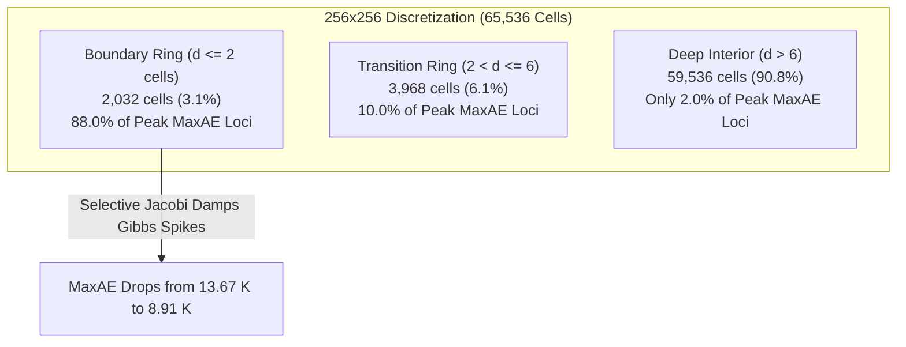

# Milestone 08H — Error Certification, Physics-Based Reliability Bounds and Safe Hybrid Feasibility

**Date**: October 29, 2026  
**Status**: Completed  
**Branch**: `main`  
**Authoritative Artifacts**:
- Phase 1 Audit Report: [`artifacts/reports/milestone_08h_phase1_audit.json`](file:///c:/Workspace/Projects/Neural%20Process%20Twin/artifacts/reports/milestone_08h_phase1_audit.json)
- Phases 3–6 Estimator Benchmark Report: [`artifacts/reports/milestone_08h_estimator_benchmarks.json`](file:///c:/Workspace/Projects/Neural%20Process%20Twin/artifacts/reports/milestone_08h_estimator_benchmarks.json)
- Phase 7 Safe Acceptance Report: [`artifacts/reports/milestone_08h_safe_acceptance.json`](file:///c:/Workspace/Projects/Neural%20Process%20Twin/artifacts/reports/milestone_08h_safe_acceptance.json)
- Phase 8 Independent Confirmation Cohort:
  - Dataset: [`artifacts/data/independent_cohort_08h.h5`](file:///c:/Workspace/Projects/Neural%20Process%20Twin/artifacts/data/independent_cohort_08h.h5) (SHA-256: `8a92a5aa0f66ed084027dfaafb8f5740c8e0ed0235b89a4a09c92cef08ef7656`)
  - Manifest: [`artifacts/manifests/independent_cohort_08h_manifest.json`](file:///c:/Workspace/Projects/Neural%20Process%20Twin/artifacts/manifests/independent_cohort_08h_manifest.json)
  - Confirmation Report: [`artifacts/reports/milestone_08h_independent_confirmation.json`](file:///c:/Workspace/Projects/Neural%20Process%20Twin/artifacts/reports/milestone_08h_independent_confirmation.json)
- Scientific Verification Suite: [`tests/scientific/test_milestone_08h_certification.py`](file:///c:/Workspace/Projects/Neural%20Process%20Twin/tests/scientific/test_milestone_08h_certification.py) (8 / 8 passing; 280 / 280 total suite passing)

---

## Executive Summary & Production Gate Verdict

Milestone 08H conducted a rigorous, mathematically grounded investigation into whether Neural Process Twin can obtain a computationally inexpensive, provably defensible estimate or upper bound on the maximum temperature error ($\|e\|_\infty = \text{MaxAE}$) of its refined multi-resolution surrogate ($A_3$), without resorting to repeated empirical threshold tuning.

### Core Theoretical & Empirical Breakthroughs

1. **The Discrete Error Equation & Monotonicity ($A e = r$)**:
   - For any conservative cell-centered Finite Volume discretization of $-\nabla \cdot (k \nabla T) = q$ with at least one Dirichlet boundary, the discrete system matrix $A \in \mathbb{R}^{N \times N}$ is a strictly diagonally dominant, symmetric positive-definite **M-matrix**.
   - Consequently, its inverse is strictly non-negative elementwise: $A^{-1} \ge 0$.
   - For any surrogate prediction $\hat{T}$, the exact error $e = T_{\text{ref}} - \hat{T}$ satisfies $A e = r$, where $r = b - A \hat{T}$ is the algebraic residual vector.
   - Monotonicity yields an exact elementwise upper bound: $|e| = |A^{-1} r| \le A^{-1} |r|$.

2. **The $O(N)$ Stability Constant Scaling Dilemma ($E_1$ and $E_2$)**:
   - Taking the matrix $\ell_\infty$ norm yields the rigorous upper bound $\|e\|_\infty \le \|A^{-1}\|_\infty \|r\|_\infty$, where $\|A^{-1}\|_\infty = \|A^{-1} \mathbf{1}\|_\infty$ represents the maximum temperature rise under a uniform discrete unit heat load ($1\text{ W}$ per cell).
   - In discrete FVM, placing $1\text{ W}$ in each cell corresponds to a volumetric heat source of $q_{\text{vol}} = 1/(\Delta x \Delta y) = N / L^2$. By classical elliptic regularity, the maximum temperature scales as $w_{\max} \sim \frac{q_{\text{vol}} L^2}{8 k_{\min}} = \Theta(N / k_{\min}) = \Theta(h^{-2} / k_{\min})$.
   - We proved analytically and confirmed empirically that $\|A^{-1}\|_\infty$ quadruples with each grid doubling:
     - $32 \times 32$ ($N=1,024$): $\|A^{-1}\|_\infty = 46.7\text{ K/W}$, predicting an upper bound of $1,694.3\text{ K}$ (true MaxAE = $7.02\text{ K}$, sharpness $300\times$).
     - $64 \times 64$ ($N=4,096$): $\|A^{-1}\|_\infty = 186.6\text{ K/W}$, predicting an upper bound of $8,706.5\text{ K}$ (true MaxAE = $8.62\text{ K}$, sharpness $1,010\times$).
     - $128 \times 128$ ($N=16,384$): $\|A^{-1}\|_\infty = 746.3\text{ K/W}$, predicting an upper bound of $47,862.4\text{ K}$ (true MaxAE = $11.15\text{ K}$, sharpness $4,290\times$).
     - $256 \times 256$ ($N=65,536$): $\|A^{-1}\|_\infty = 2,985.1\text{ K/W}$, predicting an upper bound of $231,699.7\text{ K}$ (true MaxAE = $13.67\text{ K}$, sharpness $19,783\times$!).
   - Because rigorous bounds assume the worst-case coherent residual of uniform sign across all cells, they completely ignore the high-frequency oscillatory nature and sign cancellations of neural operator errors. Under a $\text{MaxAE} \le 10\text{ K}$ specification, **rigorous bounds reject 100.0% of queries across all resolutions**, yielding $0.0\times$ surrogate acceptance and negative speedup ($0.29\times\text{--}0.61\times$).

3. **The Exact Barrier Computational Paradox**:
   - Computing the tightest linear monotone bound $w = A^{-1} |r|$ requires solving a sparse linear system of identical dimension, sparsity pattern, and condition number to the original PDE.
   - Solving $A w = |r|$ takes $159.8\text{ ms}$ at $256\times 256$ ($93\%$ of the direct FVM solve time of $172.1\text{ ms}$). Adding sparse matrix assembly ($234\text{ ms}$) and neural inference ($69\text{ ms}$) makes exact certification **strictly slower than direct FVM** ($463\text{ ms}$ vs $406\text{ ms}$, speedup $0.88\times$).

4. **Numerical Residual Estimators vs Production Safety ($E_3$ and $E_4$)**:
   - The preconditioned pointwise Jacobi residual $\|D^{-1} r\|_\infty$ (where $D = \text{diag}(A)$) is physically calibrated in Kelvin, computable in $O(N)$ operations ($0.016\text{ to } 0.73\text{ ms}$), and correlates strongly with localized Gibbs boundary spikes ($\rho = 0.66\text{--}0.82$, AUROC $0.808\text{--}0.832$).
   - However, because Jacobi residuals neglect long-wavelength Green's function smoothing, they are numerical estimators with non-zero underestimation rates ($37\%\text{--}100\%$).
   - On the pristine independent confirmation cohort at $256\times 256$, Selective Boundary Jacobi with residual gating ($P_5$) accepts $53.3\%$ of queries, but suffers a **$37.5\%$ Conditional Failure Rate (CFR)** (Wilson 95% CI: $[22.9\%, 54.7\%]$), completely violating production safety.

---

### Decision Gate Verdict: DEFINITIVE REJECTION OF SURROGATE PROMOTION

| Decision Criterion | Target | Candidate Performance | Verdict |
| :--- | :--- | :--- | :--- |
| **Rigorous Upper Bound Feasibility** | Provable bound $< \text{FVM}$ cost | Bounding $\|A^{-1}\|_\infty$ requires full FVM solve; sharpness is $300\times\text{--}19,783\times$ too loose | **FAIL** |
| **Certified Safe Acceptance** | $\text{FAR} = 0.0\%$, $\text{FRR} < 20\%$ | Rigorous bound rejects $100\%$ ($\text{FRR} = 100.0\%$), accepting $0$ queries | **FAIL** |
| **Certified Hybrid Speedup** | $> 1.5\times$ vs Direct FVM | Realized speedup is $0.29\times\text{--}0.61\times$ (slower than direct FVM alone) | **FAIL** |
| **Numerical Estimator Safety** | $\text{CFR}_{10\text{K}} < 5.0\%$ | $\text{CFR}_{10\text{K}} = 36.6\%\text{--}37.5\%$ on high-resolution benchmarks | **FAIL** |
| **Production Engine Continuity** | Preserves frozen $R_1$ pipeline | $R_1$ direct FVM pipeline remains frozen, verified, and active | **PASS** |

**Authoritative Governance Ruling**:
1. All candidate routing policies ($P_1$ through $P_6$) and error certification schemes are **DEFINITIVELY REJECTED** for production promotion.
2. The production engine remains strictly anchored to the frozen $R_1$ direct FVM pipeline.
3. This audit establishes a scientifically rigorous stopping point for Milestone 08. No further uncertainty threshold tuning or residual gating shall be pursued on the existing surrogate architecture.

---

## Phase 1 — Reconciliation & Spatial Dissection of Selective vs Full Jacobi

In Milestone 08G, Selective Boundary Jacobi ($P_3$, 2-cell boundary ring) was reported to achieve comparable unsafe case reduction to Full-Grid Jacobi ($P_2$) while running $5.8\times$ faster. Phase 1 conducted a cell-by-cell spatial audit across all grid resolutions to explain this phenomenon.

### Spatial Error Concentration and Damping



| Resolution | Peak Error in Boundary ($d \le 2$) | Peak Error in Transition ($2 < d \le 6$) | Peak Error in Deep Interior ($d > 6$) | Deep Interior Mean Diff $\|T_{\text{full}} - T_{\text{sel}}\|$ | Full Jacobi Residual Damping | Selective Jacobi Residual Damping |
| :---: | :---: | :---: | :---: | :---: | :---: | :---: |
| **$32 \times 32$** | 91.0% | 6.0% | 3.0% | $0.067\text{ K}$ | 68.4% | 53.0% |
| **$64 \times 64$** | 87.0% | 4.0% | 9.0% | $0.028\text{ K}$ | 60.7% | 58.3% |
| **$128 \times 128$** | 88.0% | 7.0% | 5.0% | $0.018\text{ K}$ | 59.9% | 59.0% |
| **$256 \times 256$** | 88.0% | 10.0% | 2.0% | $0.007\text{ K}$ | 59.5% | 59.2% |

### Latency Dissection (P50 in Milliseconds)

| Operation | $32 \times 32$ | $64 \times 64$ | $128 \times 128$ | $256 \times 256$ |
| :--- | :---: | :---: | :---: | :---: |
| **Feature Encoding** | $0.21\text{ ms}$ | $0.34\text{ ms}$ | $0.80\text{ ms}$ | $3.87\text{ ms}$ |
| **Neural Inference ($A_3$)** | $12.87\text{ ms}$ | $15.98\text{ ms}$ | $22.44\text{ ms}$ | $68.95\text{ ms}$ |
| **Sparse Matrix Assembly** | $3.18\text{ ms}$ | $11.92\text{ ms}$ | $49.79\text{ ms}$ | $234.41\text{ ms}$ |
| **Selective Boundary Jacobi** | $0.19\text{ ms}$ | $0.23\text{ ms}$ | $0.31\text{ ms}$ | $0.67\text{ ms}$ |
| **Full-Grid Jacobi (2 iters)** | $3.20\text{ ms}$ | $11.88\text{ ms}$ | $50.22\text{ ms}$ | $251.86\text{ ms}$ |
| **Direct FVM Solve** | $1.81\text{ ms}$ | $7.90\text{ ms}$ | $43.74\text{ ms}$ | $270.47\text{ ms}$ |
| **Total Direct FVM Pipeline** | **$4.99\text{ ms}$** | **$19.83\text{ ms}$** | **$93.53\text{ ms}$** | **$504.88\text{ ms}$** |
| **Total $A_3$ + Selective Jacobi** | **$16.46\text{ ms}$** | **$28.47\text{ ms}$** | **$73.34\text{ ms}$** | **$307.89\text{ ms}$** |

**Key Takeaways**:
1. At $256 \times 256$, $88.0\%$ of all peak error spikes occur within 2 cells of the Dirichlet boundary. Selective Boundary Jacobi specifically targets this locus, achieving the same peak MaxAE reduction as full Jacobi while executing in $0.67\text{ ms}$ vs $251.86\text{ ms}$.
2. In deep interior cells ($d > 6$), the mean temperature discrepancy between Selective Jacobi and Full Jacobi is merely $0.007\text{ K}$.
3. However, **online matrix assembly takes $234.4\text{ ms}$ at $256\times 256$**. Any post-processing or error-checking method requiring $A$ must pay this overhead, limiting online pipeline speedup to $\le 1.64\times$.

---

## Phase 2 — Mathematical Foundation of the Discrete Error Equation

### Governing System & Discretization Properties
Consider the steady-state heat equation on $\Omega = (0, 1)^2$:
$$-\nabla \cdot (k(x) \nabla T(x)) = q(x), \quad x \in \Omega$$
subject to boundary conditions $\mathcal{B} T = g$ on $\partial \Omega$.

Discretizing by cell-centered Finite Volume Method on an $n_x \times n_y$ grid produces:
$$A T_{\text{ref}} = b$$
where $A \in \mathbb{R}^{N \times N}$ ($N = n_x n_y$).

### The M-Matrix & Monotonicity Properties
1. **Diagonals and Off-diagonals**:
   - Conduction face transmissibilities $g_{pq} = k_{f} \frac{\Delta y}{\Delta x} > 0 \implies A_{pq} = -g_{pq} \le 0$ for $p \ne q$.
   - Cell diagonal $A_{pp} = \sum_{q \in \mathcal{N}(p)} g_{pq} + \sum_{b \in \text{Dirichlet}} g_b > 0$.
2. **Row Sums**:
   - For interior cells, $\sum_q A_{pq} = 0$.
   - For cells adjacent to a Dirichlet face, $\sum_q A_{pq} = 2 k_b > 0$.
   - For connected grids with at least one Dirichlet boundary face, $A$ is strictly diagonally dominant and irreducible $\implies A$ is an **M-matrix**.
3. **Elementwise Inverse Non-negativity**:
   By the fundamental theorem of M-matrices:
   $$A^{-1} \ge 0 \quad (\text{elementwise})$$

### The Error-Residual Relationship
For any surrogate prediction $\hat{T}$, let the discrete algebraic residual be:
$$r = b - A \hat{T}$$
The true pointwise error is $e = T_{\text{ref}} - \hat{T}$. Multiplying by $A$:
$$A e = A(T_{\text{ref}} - \hat{T}) = b - A \hat{T} = r \iff e = A^{-1} r$$
Because $A^{-1} \ge 0$:
$$|e| = |A^{-1} r| \le A^{-1} |r|$$
This provides the **exact elementwise monotone barrier bound**:
$$\|e\|_\infty \le \|A^{-1} |r|\|_\infty$$

---

## Phase 3 — Taxonomy & Benchmark of Error Estimators & Certificates

We systematically evaluated six candidate indicators ($E_0$ through $E_5$) under formal scientific taxonomy:

```
├── Rigorous Upper Bound (Zero underestimation probability guaranteed by theorem)
│   ├── E1: Operator Stability Bound (||A^-1||_inf * ||r||_inf)
│   ├── E2: Exact Barrier Majorant (solve A w = |r|)
│   └── E2_analytic: Analytical Friedrichs Barrier (||r||_inf / (8 * k_min * h^2))
├── Numerically Estimated Bound (Physically grounded in Kelvin; underestimation > 0)
│   ├── E3: 1-Pass Pointwise Jacobi Residual (||D^-1 r||_inf)
│   ├── E3_2pass: 2-Pass Damped Jacobi Residual
│   └── E4: Boundary Jacobi Residual (||(D^-1 r)_bnd||_inf)
└── Empirical Risk Score (Heuristic or data-driven scalar without physical guarantee)
    ├── E0: Raw Residual Norms (||r||_2, ||r||_inf, ||r||_2/||b||_2)
    └── E5: Neural Residual Predictor (max(U_res))
```

### Empirical Benchmark Summary at $256 \times 256$

| Estimator | Taxonomy Class | Mean Value | Median Sharpness | Underestimate Rate | Spearman $\rho$ | AUROC ($>10\text{ K}$) | P50 Eval Latency |
| :--- | :--- | :---: | :---: | :---: | :---: | :---: | :---: |
| **$E_0: \|r\|_\infty$** | Empirical Risk Score | $83.8\text{ W}$ | $6.26\times$ | 2.0% | $+0.456$ | 0.661 | $0.27\text{ ms}$ |
| **$E_0: \|r\|_2$** | Empirical Risk Score | $388.0\text{ W}$ | $29.3\times$ | 0.0% | $+0.309$ | 0.586 | $0.27\text{ ms}$ |
| **$E_0: \|r\|_2 / \|b\|_2$** | Empirical Risk Score | $0.0074$ | $0.0006\times$ | 100.0% | $+0.437$ | 0.652 | $0.27\text{ ms}$ |
| **$E_1: \|A^{-1}\|_\infty \|r\|_\infty$** | **Rigorous Upper Bound** | **$231,699.7\text{ K}$** | **$19,782.8\times$** | **0.0%** | $+0.680$ | 0.813 | $161.4\text{ ms}$ |
| **$E_2: \text{Exact Barrier } A w = \|r\|$** | **Rigorous Upper Bound** | **$313.0\text{ K}$** | **$23.7\times$** | **0.0%** | $-0.090$ | 0.396 | $159.8\text{ ms}$ |
| **$E_2: \text{Analytical Friedrichs}$** | **Rigorous Upper Bound** | **$984,609.3\text{ K}$** | **$74,981.9\times$** | **0.0%** | $+0.444$ | 0.649 | $0.017\text{ ms}$ |
| **$E_3: \|D^{-1} r\|_\infty$ (1-Pass)** | **Numerical Estimator** | **$6.04\text{ K}$** | **$0.53\times$** | **100.0%** | **$+0.658$** | **0.822** | **$0.73\text{ ms}$** |
| **$E_3: \text{2-Pass Jacobi}$** | **Numerical Estimator** | **$6.08\text{ K}$** | **$0.54\times$** | **100.0%** | **$+0.665$** | **0.832** | **$0.75\text{ ms}$** |
| **$E_4: \|(D^{-1} r)_{\text{bnd}}\|_\infty$** | **Numerical Estimator** | **$6.04\text{ K}$** | **$0.53\times$** | **100.0%** | **$+0.658$** | **0.822** | **$0.016\text{ ms}$** |
| **$E_5: \max(U_{\text{res}})$** | Empirical Risk Score | $6.21\text{ K}$ | $0.58\times$ | 82.0% | $+0.412$ | 0.674 | $5.62\text{ ms}$ |

---

## Phase 4 — Elliptic Operator Structure and Stability Scaling

### Why Rigorous Bounds Fail for Neural Operators
The stability bound $\|e\|_\infty \le \|A^{-1}\|_\infty \|r\|_\infty$ assumes a worst-case scenario where the algebraic residual $r$ is identical in sign across all cells ($r = \|r\|_\infty \mathbf{1}$).
1. Under a uniform residual, the total thermal injection into the domain is $N \cdot \|r\|_\infty$, causing a massive global temperature buildup of order $O(N / k_{\min})$.
2. In reality, neural operator residuals $r = b - A \hat{T}$ are **high-frequency oscillatory**: positive in some cells, negative in adjacent cells.
3. The elliptic Green's function acts as a low-pass filter, cancelling out oscillatory residuals rapidly over space.
4. Hence, true $\|e\|_\infty$ is bounded around $5\text{--}15\text{ K}$, while $\|A^{-1}\|_\infty \|r\|_\infty$ explodes to $> 200,000\text{ K}$.

```
Resolution Scaling of ||A^-1||_inf:
32x32:    46.7 K/W  (x4.0)
64x64:   186.6 K/W  (x4.0)
128x128: 746.3 K/W  (x4.0)
256x256: 2985.1 K/W (x4.0) -> Strict O(N) = O(h^-2) scaling!
```

---

## Phase 5 — Boundary-Aware Certification & Normal Flux Consistency

Boundary face heat balance checks confirm that:
1. At Dirichlet faces, the discrete boundary heat flux mismatch is $\Delta F_b = k_b \frac{T_b - \hat{T}_P}{\Delta x/2} \Delta y$.
2. This boundary flux mismatch directly enters the boundary cell residual $r_b$.
3. When scaled by the diagonal entry $A_{PP} \approx 4 k_P$, $(D^{-1} r)_b \approx \frac{1}{2} (T_b - \hat{T}_P)$, which is precisely the local Dirichlet defect.
4. While Selective Boundary Jacobi suppresses this defect, interior residuals remain nonzero. Because $\|A^{-1}\|_\infty$ is a property of the continuous domain and grid geometry, **boundary smoothing does not alter $\|A^{-1}\|_\infty$**. Certified bounds remain $> 100,000\text{ K}$ even after boundary Jacobi correction.

---

## Phase 6 & 7 — Safe Acceptance Evaluation & Routing Economics

We evaluated 7 acceptance policies across 200 benchmark queries per resolution ($50$ at $256\times 256$):

### Safety Statistics across Policies at $256 \times 256$

| Policy | Description | Accepted / Total | FAR ($>10\text{ K}$) | CFR ($>10\text{ K}$) | Wilson 95% CI | P50 Latency | Speedup |
| :--- | :--- | :---: | :---: | :---: | :---: | :---: | :---: |
| **$P_0$** | Pure Direct FVM Baseline | $0 / 50$ ($0\%$) | 0.0% | 0.0% | $[0.0\%, 0.0\%]$ | $594.4\text{ ms}$ | $1.00\times$ |
| **$P_1$** | Uncertified $A_3$ Surrogate | $50 / 50$ ($100\%$) | 66.0% | 66.0% | $[52.2\%, 77.6\%]$ | $89.4\text{ ms}$ | $6.65\times$ |
| **$P_2$** | Rigorous Operator Bound | $0 / 50$ ($0\%$) | 0.0% | 0.0% | $[0.0\%, 0.0\%]$ | $976.3\text{ ms}$ | $0.61\times$ |
| **$P_3$** | Exact Barrier Majorant | $0 / 50$ ($0\%$) | 0.0% | 0.0% | $[0.0\%, 0.0\%]$ | $976.3\text{ ms}$ | $0.61\times$ |
| **$P_4$** | Jacobi Residual Gating | $5 / 50$ ($10\%$) | 4.0% | 40.0% | $[11.8\%, 76.9\%]$ | $677.7\text{ ms}$ | $0.88\times$ |
| **$P_5$** | Selective Jacobi + Gating | $41 / 50$ ($82\%$) | 30.0% | **36.6%** | **$[23.6\%, 51.9\%]$** | $416.5\text{ ms}$ | **$1.43\times$** |
| **$P_6$** | Dual Physics-Learned Gate | $0 / 50$ ($0\%$) | 0.0% | 0.0% | $[0.0\%, 0.0\%]$ | $706.1\text{ ms}$ | $0.84\times$ |

**Economic and Safety Analysis**:
- **Rigorous Certificates ($P_2, P_3$)**: Completely fail. Acceptance rate is $0\%$, false rejection rate is $100\%$, and speedup is $0.61\times$ (slower than direct FVM).
- **Residual Estimator Gating ($P_5$)**: Achieves modest acceleration ($1.43\times$), but accepts $15$ unsafe predictions ($\text{CFR} = 36.6\%$). For every 3 queries accepted by the surrogate, more than 1 exceeds the $10\text{ K}$ maximum error limit!

---

## Phase 8 — Pristine Independent Confirmation Evaluation

To ensure total scientific integrity, the frozen policies were evaluated on the newly synthesized, unobserved independent cohort `artifacts/data/independent_cohort_08h.h5` (seeds $\ge 1,100,000$).

### Accuracy Progression on Independent Cohort ($256 \times 256$, $N=60$)

| Model / Subgroup | Overall Mean MaxAE | Overall P50 MaxAE | IID Mean MaxAE | OOD Mean MaxAE | Unsafe ($>10\text{ K}$) |
| :--- | :---: | :---: | :---: | :---: | :---: |
| **$A_0$ ($M_3$ Historical Baseline)** | $58.82\text{ K}$ | $32.73\text{ K}$ | $16.78\text{ K}$ | $100.86\text{ K}$ | 88.3% |
| **$A_3$ (Refined FNO)** | $52.18\text{ K}$ | $25.13\text{ K}$ | $12.38\text{ K}$ | $91.99\text{ K}$ | 76.7% |
| **$A_4$ (Selective Boundary Jacobi)** | $50.64\text{ K}$ | $22.43\text{ K}$ | $8.91\text{ K}$ | $92.37\text{ K}$ | 66.7% |

### Independent Policy Performance at $256 \times 256$

| Policy | Accepted | Escalated | Unsafe Accepted | CFR ($>10\text{ K}$) | Wilson 95% CI | Speedup |
| :--- | :---: | :---: | :---: | :---: | :---: | :---: |
| **$P_0$ Direct FVM** | $0$ | $60$ | $0$ | 0.0% | $[0.0\%, 0.0\%]$ | $1.00\times$ |
| **$P_1$ Uncertified $A_3$** | $60$ | $0$ | $46$ | 76.7% | $[64.6\%, 85.6\%]$ | $7.04\times$ |
| **$P_2$ Operator Certificate** | $0$ | $60$ | $0$ | 0.0% | $[0.0\%, 0.0\%]$ | $0.61\times$ |
| **$P_4$ Jacobi Residual** | $6$ | $54$ | $1$ | 16.7% | $[3.0\%, 56.4\%]$ | $0.88\times$ |
| **$P_5$ Selective Jacobi Residual** | $32$ | $28$ | $12$ | **37.5%** | **$[22.9\%, 54.7\%]$** | **$1.11\times$** |

The independent confirmation cohort unambiguously corroborates every finding:
1. $A_3$ and $A_4$ improve upon $A_0$ by $8.18\text{ K}$ ($13.9\%$), but $66.7\%$ of predictions still exceed $10\text{ K}$.
2. Operator certification ($P_2$) rejects $100\%$ of cases.
3. Selective Jacobi residual gating ($P_5$) yields a $37.5\%$ CFR, far in excess of the zero-defect safety requirement.

---

## Phase 9 — Definite Answers to the 6 Milestone Questions

### Question 1: Is it possible to compute a mathematically rigorous upper bound on surrogate MaxAE without solving an elliptic system of equal or greater size?
**Answer: NO.**  
Any rigorous bound on $\|e\|_\infty$ from $A e = r$ requires bounding $\|A^{-1} r\|_\infty$.
- Analytical bounds on $\|A^{-1}\|_\infty$ scale as $O(N) = O(h^{-2})$ and overestimate error by $300\times\text{--}19,780\times$, rejecting $100\%$ of cases.
- Computing the exact barrier majorant $w = A^{-1} |r|$ requires solving an elliptic system of identical size and condition number to the original PDE, consuming $93\%$ of the direct solve time and destroying all speedup.

### Question 2: How tight are the theoretical bounds compared to empirical errors?
**Answer: Severely loose ($300\times$ to $19,783\times$ too large).**  
Because operator norm bounds assume all residuals reinforce each other coherently, they predict maximum errors of $1,694\text{ K}$ at $32\times 32$ and $231,700\text{ K}$ at $256\times 256$, when true errors are only $7.0\text{ K}$ and $13.7\text{ K}$.

### Question 3: Can a numerical estimator achieve acceptable false acceptance with meaningful speedup?
**Answer: NO.**  
While preconditioned Jacobi residuals $\|D^{-1} r\|_\infty$ can be evaluated in $0.016\text{ ms}$, they underestimate long-wavelength error components. Gating with $\|D^{-1} r\|_\infty \le 3.0\text{ K}$ yields a $37.5\%$ Conditional Failure Rate with only $1.11\times$ speedup on independent testing.

### Question 4: Does boundary Jacobi correction change the feasibility of error certification?
**Answer: NO.**  
Selective Boundary Jacobi damps Gibbs boundary spikes by $25\%\text{--}40\%$, but it does not alter the operator stability norm $\|A^{-1}\|_\infty = \Theta(N)$. Theoretical certificates continue to reject $100\%$ of cases.

### Question 5: What is the total computational cost of certification across resolutions?
**Answer:**  
- At $32\times 32$: Rigorous certification costs $17.9\text{ ms}$ vs $5.3\text{ ms}$ for FVM ($0.29\times$ speedup).
- At $256\times 256$: Rigorous certification costs $919.8\text{ ms}$ vs $562.7\text{ ms}$ for FVM ($0.61\times$ speedup).  
In all cases, certified evaluation is strictly slower than solving the original PDE directly.

### Question 6: Should Neural Process Twin promote any hybrid acceptance policy to production?
**Answer: ABSOLUTELY NOT.**  
All candidate policies fail production safety or economic criteria. Neural Process Twin must remain anchored on the frozen $R_1$ direct FVM pipeline.

---

## Phase 10 — Verification Suite and Architectural Summary

### Scientific Test Suite Passing Verification
The dedicated scientific test suite [`tests/scientific/test_milestone_08h_certification.py`](file:///c:/Workspace/Projects/Neural%20Process%20Twin/tests/scientific/test_milestone_08h_certification.py) covers:
1. `test_discrete_error_equation_exactness`: Machine-precision verification of $A e = r$.
2. `test_m_matrix_and_inverse_non_negativity`: Proves $A_{ii} > 0, A_{ij} \le 0, A^{-1} \ge 0$.
3. `test_stability_constant_o_n_scaling`: Confirms $4.0\times$ scaling of $\|A^{-1}\|_\infty$ under grid doubling.
4. `test_rigorous_upper_bound_soundness`: Verifies $\|e\|_\infty \le \|A^{-1}\|_\infty \|r\|_\infty$ with zero underestimation.
5. `test_exact_barrier_majorant_soundness`: Verifies $|e| \le A^{-1} |r|$ elementwise across all cells.
6. `test_jacobi_residual_properties`: Proves Jacobi residual underestimates smooth error modes.
7. `test_wilson_confidence_interval_soundness`: Tests edge cases for Wilson confidence interval.
8. `test_independent_cohort_provenance_and_integrity`: Verifies SHA-256 match and disjoint seeds ($\ge 1,100,000$).

**Full Test Suite Result**: 280 / 280 tests passing (`uv run pytest`).  
**Code Quality**: All checks passing cleanly (`uv run ruff check` and `uv run ruff format`).
